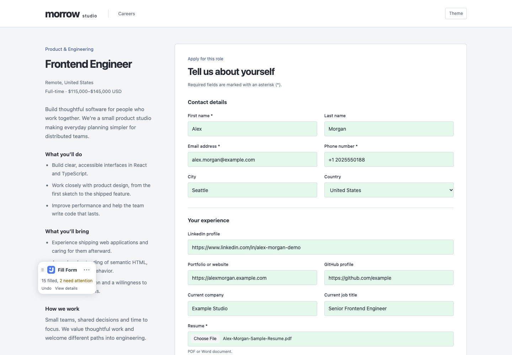

# Job Buddy

AI-powered job application assistant browser extension

Save your profile once and use Job Buddy to fill supported job application forms.
Import your resume, review your details, and fill forms with one click.

[Chrome Web Store](https://chromewebstore.google.com/detail/job-buddy/oaadklbdofbaanfcijknaehfkbekdmbk) · [Website](https://myowinthein.github.io/job-buddy/)

## Why I built this

While actively looking for a job, I found myself filling out several application
forms every day. Repeating the same personal details, work history, and education
was exhausting and took time away from the search itself.

I tried extensions from the Chrome Web Store. Some included job listings, resume
matching, and other features I didn't need. Others were simpler, but didn't fill
forms as accurately as I wanted.

That's why I built Job Buddy. I wanted a simple, reliable extension that could read
my resume and use AI to help fill application forms in one click. I built it for my
own job search and made it free and open source for others to use.

## How to use it

After installing Job Buddy, you need two things: a
[Gemini API key](https://aistudio.google.com/api-keys) and your resume in PDF or DOCX
format. Gemini offers a free tier, with
[usage limits](https://ai.google.dev/gemini-api/docs/rate-limits) that vary by model.

1. Open **Settings → AI Features**, enter your key, and select **Save Key**.
2. Choose **Import Resume**, review and import your details, then complete your profile.
3. Open a job application form and select **Fill Form** from Job Buddy.
4. Review the answers, complete anything missing, and submit on the application site.

Your profile stays in your browser. Resume import and autofill send relevant data
to Gemini.

## Help me improve it

If something doesn't work, or you have an idea that would make applying for jobs
easier, [share it on GitHub](https://github.com/myowinthein/job-buddy/issues).

[MIT](LICENSE) © 2026 Myo Win Thein (Martin).

<!-- last-reviewed: 80054c5fef2789f50223b7a134e940e3efd9981c -->
